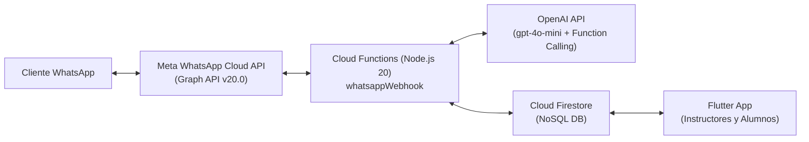
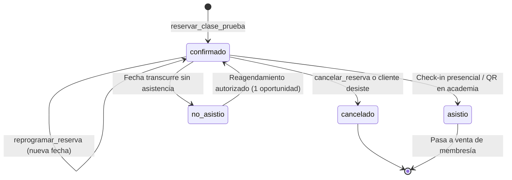
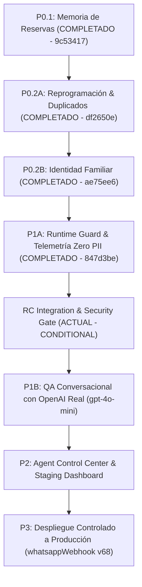

# Estado Actual del Proyecto GINGA (CURRENT-STATE)

> **Documento Maestro de Estado y Arquitectura**  
> **Última Actualización:** 2026-11-11  
> **Rama Actual:** `fix/real-whatsapp-logic`  
> **Commit HEAD:** `847d3be` (`feat(agent): runtime mutation guard and tool execution audit`)  
> **Producción Intacta:** `3058ada` (main, `whatsappWebhook v67`)  
> **Estado RC:** CONDITIONAL (Apto para Staging / QA Real, Bloqueado para Despliegue Directo a Producción)

---

## 1. Arquitectura y Tecnologías

El sistema real de GINGA es una plataforma de atención comercial y gestión de academia de Capoeira que opera como un **single-agent con function calling**:



### Componentes Clave:
- **Runtime Backend:** Node.js 20 en Google Cloud Functions (Firebase Functions v4.4.1).
- **Orquestación Conversacional:** Modelo `gpt-4o-mini` vía OpenAI Chat Completions API con tool-calling secuencial (tope de 4 rondas por turno).
- **Base de Datos:** Cloud Firestore en modo nativo (`capoeirafiu-ea8ljo`).
- **Canal de Mensajería:** Meta WhatsApp Cloud API con verificación de firma HMAC-SHA256 (`X-Hub-Signature-256`), deduplicación por `wa_message_id` y debounce de 5.0 segundos.
- **Frontend Móvil:** Aplicación Flutter multirol (`alumno`, `profesor`) en iOS y Android.
- **Harness de Pruebas Aislado (`real_agent_harness/`):** Servidor local (`http://127.0.0.1:3333`) que ejecuta el código real de `functions/index.js` en memoria con emuladores puros de Firestore, OpenAI y WhatsApp.

---

## 2. Ramas y Commits Relevantes

| Rama | Commit HEAD | Propósito y Estado |
|---|---|---|
| **`main`** | `3058ada` | **Producción activa.** Coincide exactamente con la revisión `whatsappWebhook v67` desplegada en Google Cloud el 23-OCT-2026. Tag: `pre-live-original-2026-10-27`. |
| **`fix/real-whatsapp-logic`** | `bd36b9a` (+ P1A local) | **Rama de desarrollo real activa.** Contiene el harness (`b1c3af6`), P0.1 (`9c53417`), master docs (`264e314`), P0.2A (`df2650e`), P0.2B (`ae75ee6`), decisión 5 multisede (`bd36b9a`) e implementación local de **P1A (Runtime Guard y Telemetría Zero PII)** lista para revisión. |
| `stabilization/pre-live-2026-10-28` | `caf628a` | Línea independiente de estabilización previa al LIVE de TikTok (controles de seguridad e idempotencia). |
| `demo/tiktok-live-2026-10-28` | `7243a7f` | Línea exclusiva de demostración visual en memoria para grabación y TikTok LIVE (código aislado en `demo/`). |

---

## 3. Estado Real: Producción vs. Desarrollo vs. Simulador

- **Producción (`whatsappWebhook v67` en `main` `3058ada`):**
  - Intacta, sin cambios, sin despliegue.
  - Opera con amnesia de reservas: `generarSystemPrompt` no consulta `/reservas`.
  - Sufre bloqueo de reservas si el lead tiene una reserva cancelada o pasada.
  - No soporta reprogramación de fechas; arriesga alucinaciones de confirmación de palabra.
- **Desarrollo Local (`fix/real-whatsapp-logic`):**
  - **P0.1 implementado:** `generarSystemPrompt` recibe `leadId` y consulta `/reservas` activas en `America/Lima` (commit `9c53417`, 14/14 tests PASS).
  - **P0.2A implementado:** Tool real `reprogramar_reserva` con persistencia atómica, corrección de duplicados, salvaguardas comerciales y lock transaccional (commit `df2650e`, 22/22 tests PASS).
  - **P0.2B implementado:** Identidad familiar no destructiva, aislamiento por alumno y soporte para múltiples reservas (commit `ae75ee6`, 10/10 tests PASS).
  - **Gate de Integración completado:** Consolidación de Decisiones 5 y 13 (commit `bd36b9a`).
  - **P1A implementado localmente:**
    - Runtime Guard determinista post-generación en `preguntarIA`.
    - Detección semántica de afirmaciones no respaldadas (`booking`, `reschedule`, `cancellation`) y contradicciones de rechazos de tools.
    - Validación estructurada de correspondencia de **persona**, **fecha** y **tipo de operación**.
    - Prevención de contradicciones en resultados mixtos familiares (un hijo confirmado y otro rechazado por cupos).
    - Sustitución automática por mensaje seguro y escalación a `requiere_atencion` con detección de `alreadyEscalated`.
    - Fallback técnico transparente si la persistencia de base de datos falla, sin falsas promesas.
    - Preservación de `ai_habilitada` (el guard no la desactiva automáticamente).
    - Telemetría estructurada Zero PII con `lead_hash` HMAC-SHA256 (`TELEMETRY_SALT`) y `persona_ref` (`p_` + hash) que previene desanonimización de teléfonos o nombres de menores.
    - Suite P1A superada al 100% (**27/27 tests PASS**).
    - Suite de línea base eliminó el defecto histórico de Caso 8 (9/9 escenarios OK, 0 defectos).
    - Total de suites de pruebas locales: **82 de 82 pruebas aprobadas (100% PASS)**.
- **Simulador Local (`real_agent_harness/`):**
  - Activo en `http://127.0.0.1:3333`.
  - Ejecuta el archivo real `functions/index.js` mediante Node.js `vm.compileFunction`.
  - Emula Firestore en memoria con fixtures de Cusco (`config/negocio`, `clases`, `users`).
  - Permite pruebas automáticas y manuales con costo cero y sin tocar la nube.

---

## 4. Catálogo de Tools Actuales

Ubicadas en `functions/index.js` (`AVAILABLE_TOOLS`):

1. **`consultar_horarios_disponibles`:**
   - *Lectura:* `/clases` (where `tipo == 'regular'`), `/config/negocio`.
   - *Salida:* Texto formateado con horarios, edades, cupos, sede Cusco, precios (S/140 regular, S/260 promo acompañados, S/380 y S/720 multimes) y número de Yape.
2. **`guardar_perfil_lead`:**
   - *Escritura:* `whatsapp_leads/{leadId}.perfil_personas`.
   - *Parámetros:* `personas` (Array de `{nombre, tipo, edad}`).
   - *Comportamiento P0.2A:* Fusión inteligente por slug (`slugifyPersona`), preservando a los hijos registrados previamente y actualizando datos sin sobreescritura destructiva.
3. **`reservar_clase_prueba`:**
   - *Lectura:* `/whatsapp_leads`, `/clases`, `/reservas`.
   - *Escritura (Transaccional):* Crea `/reservas/{id}`, actualiza `whatsapp_leads` (`reserva_id`, `fecha_clase_reservada`, `reservas_activas[slug]`) y crea notificación para el profesor en `/users/{instId}/notificaciones`.
   - *Mejoras P0.2A:*
     - Chequeo de duplicados e idempotencia dentro de `runTransaction` usando `reservas_activas[slug]`.
     - Ignora reservas con `status == 'cancelado'` o con `fecha_clase` en el pasado.
     - Intercepta estados `asistio` o `no_asistio` aplicando política comercial y derivando a `marcar_seguimiento_humano`.
     - Sugiere `reprogramar_reserva` si ya existe una cita activa confirmada para esa persona.
4. **`reprogramar_reserva` (NUEVA P0.2A):**
   - *Lectura:* `/whatsapp_leads`, `/reservas`, `/clases`.
   - *Escritura (Transaccional):* Modifica `/reservas/{id}` (`fecha_clase`, `hora`, `updated_at`), añade entrada de auditoría en `reprogramaciones`, actualiza `whatsapp_leads.reservas_activas[slug]` y crea notificación en `/users/{instId}/notificaciones`.
   - *Parámetros:* `nombre` (string opcional/deducible), `nueva_fecha` (AAAA-MM-DD), `motivo` (opcional).
   - *Protección:* Valida días de clase permitidos (`M, J`), cupos disponibles, fecha futura, y prohíbe reprogramar citas canceladas, vencidas o asistidas.
5. **`marcar_seguimiento_humano`:**
   - *Escritura:* Actualiza `whatsapp_leads.status = 'requiere_atencion'`, crea notificaciones batch en `/users` (rol profesor) y alerta por WhatsApp al instructor.

---

## 5. Pruebas Existentes y Resultados

### A. Suite de Reconocimiento de Reservas P0.1 (`test_p01_recognition.js`):
- **14 de 14 pruebas pasaron (100% PASS):**
  - Caso A: Lead nuevo sin reservas $\rightarrow$ Prompt limpio.
  - Caso B: Reserva futura confirmada $\rightarrow$ Inyectada con fecha y hora.
  - Caso C: Reserva para hoy pendiente $\rightarrow$ Reconocida como HOY.
  - Caso D: Reserva cancelada $\rightarrow$ Descartada de vigentes.
  - Caso E: Reserva pasada $\rightarrow$ Descartada de vigentes.
  - Caso F: Estado `asistio` $\rightarrow$ Descartado de pendientes.
  - Caso G: Estado `no_asistio` $\rightarrow$ Descartado de pendientes.
  - Caso H: Familia con dos hijos $\rightarrow$ Ambos hijos listados independientemente.
  - Caso I: Error de Firestore $\rightarrow$ Fail-safe sin crasheos.
  - Caso J: Directivas contra duplicación de registro $\rightarrow$ Verificadas.
  - Caso K: Reserva de hoy que ya terminó $\rightarrow$ Descartada.
  - Caso L: Protección contra promesas falsas de reprogramación $\rightarrow$ Verificada.
  - Caso M: Neutralidad de género $\rightarrow$ Verificada.
  - Caso N: Aviso de seguridad ante caída de BD $\rightarrow$ Verificado.

### B. Suite de Pruebas P0.2A (`test_p02a_rescheduling.js`):
- **22 de 22 pruebas pasaron (100% PASS):**
  1. `01_martes_a_jueves`: Reprogramación atómica en Firestore con auditoría y notificación.
  2. `02_jueves_a_martes`: Reprogramación a la semana siguiente.
  3. `03_dos_hijos_aislacion`: Independencia total de reservas entre hermanos (Valentina y Mateo).
  4. `04_reserva_inexistente`: Manejo limpio sin falsas confirmaciones.
  5. `05_reserva_cancelada`: Bloquea reprogramar canceladas pero permite crear nuevas citas.
  6. `06_politica_comercial_asistio`: Salvaguarda provisional: Bloquea segundas clases gratis tras asistir y deriva a instructor.
  7. `07_politica_comercial_no_asistio`: Salvaguarda provisional: Bloquea reagendamiento desatendido tras inasistencia.
  8. `08_reserva_pasada_vencida`: Rechaza reprogramar citas vencidas.
  9. `09_capacidad_cupos_cero`: Detecta cupos agotados y escala a lista de espera.
  10. `10_fecha_invalida_rechazo`: Fechas inválidas preservan la cita original sin alteración.
  11. `11_reprogramaciones_repetidas`: Mantiene array histórico de auditoría con motivos.
  12. `12_concurrencia_idempotencia`: Lock optimista en `whatsapp_leads` aborta duplicados concurrentes.
  13. `13_failsafe_error_firestore`: Fail-safe ante caídas de BD prohíbe promesas falsas.
  14. `14_proteccion_alucinacion`: Garantiza que el agente solo confirma tras éxito en BD.
  15. `15_compatibilidad_legacy_multisede`: Manejo limpio de documentos sin `sede_id`.
  16. `16_fusion_perfiles_multi_hijos`: Fusión acumulativa de perfiles familiares sin sobreescritura.
  17. `17_dos_leads_cupo_cero`: Control de capacidad ante múltiples leads compitiendo con cupos agotados.
  18. `18_lead_legacy_sin_reservas_activas`: Compatibilidad con leads de producción que solo tienen `reserva_id` escalar.
  19. `19_dos_hijos_nombre_ambiguo`: Rechazo de nombres ambiguos o genéricos ("mi hijo") evitando alterar la reserva errónea.
  20. `20_sede_sin_ubicacion_no_inventa`: Prohibición estricta de hardcodear o inventar direcciones no comprobadas.
  21. `21_reprogramacion_sin_segunda_clase`: Reprogramación modifica la cita existente sin conceder clases extras.
  22. `22_error_transaccional_failsafe`: Manejo seguro de abortos transaccionales por contención o cupos.

### C. Suite de Identidad Familiar P0.2B (`test_p02b_family_identity.js`):
- **10 de 10 pruebas pasaron (100% PASS):**
  1. `01_familia_dos_hijos_dos_reservas`: Documentos independientes en `/reservas` y `reservas_activas`.
  2. `02_reprogramar_hijo_sin_alterar_hermano`: Reprogramación de Mateo a jueves sin tocar reserva de Lucía en martes.
  3. `03_mensaje_ambiguo_solicita_aclaracion`: Solicitud explícita de aclaración ante referencias ambiguas.
  4. `04_referencia_inequivoca_por_nombre`: Despacho exacto a la persona indicada.
  5. `05_lead_legacy_reserva_id_escalar`: Reconciliación no destructiva con reservas históricas.
  6. `06_registro_nuevo_con_reservas_activas`: Reprogramación directa vía `reserva_id`.
  7. `07_familia_reserva_cancelada_y_activa`: Aislamiento de estados entre hermanos.
  8. `08_dos_hijos_nombres_iguales_desambiguacion`: Desambiguación forzada ante homónimos.
  9. `09_intento_operar_reserva_ajena_unauthorized`: Rechazo estricto de autorización por teléfono.
  10. `10_reintento_operacion_sin_duplicar`: Idempotencia de booking en reintentos.

### D. Suite de Runtime Guard y Telemetría P1A (`test_p1a_runtime_guard.js`):
- **27 de 27 pruebas pasaron (100% PASS):**
  1. `01_booking_tool_success_allowed`: Booking exitoso con tool persistido $\rightarrow$ ALLOW.
  2. `02_booking_without_tool_intercepted`: Alucinación verbal de booking sin tool $\rightarrow$ INTERCEPT, fallback seguro y `requiere_atencion`.
  3. `03_booking_tool_failed_intercepted`: Falla de base de datos en booking $\rightarrow$ INTERCEPT.
  4. `04_booking_tool_rejected_already_attended_intercepted`: Rechazo por `asistio` previo con alucinación $\rightarrow$ INTERCEPT.
  5. `05_booking_tool_rejected_no_show_intercepted`: Rechazo por `no_asistio` previo con alucinación $\rightarrow$ INTERCEPT.
  6. `06_booking_tool_rejected_class_full_intercepted`: Rechazo por `cupos_disponibles == 0` $\rightarrow$ INTERCEPT.
  7. `07_reschedule_tool_success_allowed`: Reprogramación exitosa persistida $\rightarrow$ ALLOW.
  8. `08_reschedule_without_tool_intercepted`: Defecto histórico baseline interceptado $\rightarrow$ INTERCEPT.
  9. `09_reschedule_tool_rejected_invalid_date_intercepted`: Rechazo por fecha de día inválido $\rightarrow$ INTERCEPT.
  10. `10_reschedule_tool_rejected_expired_date_intercepted`: Rechazo por cita vencida en el pasado $\rightarrow$ INTERCEPT.
  11. `11_preexisting_reservation_reminder_allowed`: Recordatorio de cita previa en `systemPrompt` sin tool $\rightarrow$ ALLOW.
  12. `12_consultation_horarios_allowed`: Consulta de horarios y precios sin mutación $\rightarrow$ ALLOW.
  13. `13_profile_saving_allowed`: Guardado de perfil familiar sin mutación $\rightarrow$ ALLOW.
  14. `14_human_escalation_allowed`: Escalación humana vía `marcar_seguimiento_humano` $\rightarrow$ ALLOW.
  15. `15_telemetry_zero_pii_verification`: Verificación estricta de telemetría Zero PII (`lead_hash` HMAC-SHA256, sin teléfonos en texto claro).
  16. `16_multi_tool_execution_telemetry`: Ejecución multi-tool encadenada (`guardar_perfil_lead` + `reservar_clase_prueba`) $\rightarrow$ ALLOW y telemetría íntegra.
  17. `17_booking_success_different_person_intercepted`: Éxito para Mateo pero texto afirma Lucía $\rightarrow$ INTERCEPT (discrepancia de persona).
  18. `18_booking_success_different_date_intercepted`: Éxito para martes 17 pero texto afirma jueves 19 $\rightarrow$ INTERCEPT (discrepancia de fecha).
  19. `19_cross_operation_mismatch_intercepted`: Herramienta de reserva intentando autorizar afirmación de reprogramación $\rightarrow$ INTERCEPT.
  20. `20_multi_child_mixed_results_intercepted`: Resultados mixtos (Mateo OK, Lucía rechazada) con afirmación colectiva de éxito $\rightarrow$ INTERCEPT.
  21. `21_negation_and_hypothesis_no_false_positive`: Frases explicativas de negación ("no pude agendar") e hipótesis $\rightarrow$ ALLOW (sin falso positivo).
  22. `22_unrecognized_idiom_boundary_documented`: Límite semántico documentado ante modismos atípicos sin verbos estándar ("apunté en la libreta").
  23. `23_error_on_human_escalation_safe_fallback`: Falla en Firestore durante intercepción entrega mensaje técnico sin promesas falsas.
  24. `24_retry_deduplication_already_escalated`: Reintento sobre lead ya escalado detecta `alreadyEscalated` evitando saturación de alertas.
  25. `25_telemetry_sanitization_deep_inspection`: Inspección profunda de eventos: `persona_ref` HMAC, sin nombres de menores ni teléfonos.
  26. `26_multi_turn_turncontext_isolation`: Aislamiento estricto de `TurnContext`: Turno 1 no autoriza alucinaciones en Turno 2.
  27. `27_all_llm_exit_routes_coverage`: Cobertura exhaustiva: `preguntarIA` intercepta antes de entregar texto al webhook.

### E. Suite de Línea Base (`suite_runner.js`):
- Caso 1: Consulta de horarios $\rightarrow$ **OK**.
- Caso 2: Reserva vigente $\rightarrow$ **OK**.
- Caso 3: Reserva cancelada que quiere agendar $\rightarrow$ **OK (RESUELTO EN P0.2A)**.
- Caso 4: Reserva pasada que quiere volver a reservar $\rightarrow$ **OK (RESUELTO EN P0.2A)**.
- Caso 5: Padre/madre con dos hijos y reservas diferentes $\rightarrow$ **OK (RESUELTO EN P0.2B)**.
- Caso 6: Solicitud de reprogramación martes a jueves $\rightarrow$ **OK (RESUELTO EN P0.2A)**.
- Caso 7: Persistencia documental de nueva fecha $\rightarrow$ **OK (RESUELTO EN P0.2A)**.
- Caso 8: Confirmación textual sin escritura persistida $\rightarrow$ **OK (RESUELTO EN P1A)**: Runtime Guard interceptó la promesa falsa sin persistencia.
- Caso 9: Control humano $\rightarrow$ **OK**.
- **Resultado Global de Línea Base:** **9 de 9 escenarios OK (0 defectos documentados restantes).**

---

## 6. Especificación Técnica e Implementación P0.2A: Reprogramación Segura e Integridad

> [!IMPORTANT]
> **Estado:** IMPLEMENTACIÓN LOCAL COMPLETADA Y VALIDADA. Pendiente de revisión del usuario antes de commit.

### 6.1. Reglas de Negocio y Estados de Reserva

El ciclo de vida formal de una reserva de clase de prueba se rige por la siguiente máquina de estados:



- **`confirmado`:** Reserva activa vigente con fecha futura o de hoy pendiente de inicio.
- **`cancelado`:** El cliente avisó que no podrá ir o canceló la cita. **NO debe bloquear nuevas reservas futuras**.
- **`asistio`:** El alumno asistió a su clase de prueba (registrado en `/asistencias` y `/reservas`).
- **`no_asistio`:** La fecha pasó y no hubo check-in.
- **Diferencia Operativa:**
  - *Reserva:* Registro comercial en `/reservas` asociado a un lead de WhatsApp.
  - *Asistencia:* Registro físico en `/asistencias` vinculado a una sesión presencial.
  - *Matrícula:* Alta de alumno regular en `/users` (`rol: alumno`) con pagos mensuales en `/alumnos` o `/pagos`.

### 6.2. Estrategia de Reprogramación: ¿Mismo Documento o Cancelar y Crear?
**Decisión Técnica:** **Mismo documento con historial de cambios (`audit_trail`).**
- *Justificación:* Mantener el mismo `reservaId` preserva la trazabilidad del lead en la app del instructor (evita generar notificaciones huérfanas o duplicar filas en la UI del profesor).
- *Campos a actualizar atómicamente:*
  - `fecha_clase`: Nuevo `Timestamp` a mediodía hora Lima.
  - `dias`: Días de la clase.
  - `updated_at`: `FieldValue.serverTimestamp()`.
  - `reprogramaciones`: Array append `{ fecha_anterior, fecha_nueva, motivo, timestamp }`.

### 6.3. Contratos de Herramientas para P0.2

#### Tool 1: `reprogramar_reserva` (NUEVA)
```json
{
  "name": "reprogramar_reserva",
  "description": "Cambia la fecha de una reserva de clase de prueba ya existente para un asistente. Úsala cuando el cliente pida cambiar de día (ej. pasar del martes al jueves).",
  "parameters": {
    "type": "object",
    "properties": {
      "nombre": {
        "type": "string",
        "description": "Nombre de pila del asistente cuya reserva se reprograma."
      },
      "nueva_fecha": {
        "type": "string",
        "description": "Nueva fecha solicitada en formato AAAA-MM-DD. Si no es válida o no hay clase ese día, el backend calcula la fecha permitida más próxima."
      },
      "motivo": {
        "type": "string",
        "description": "Motivo breve del cambio si el cliente lo indicó."
      }
    },
    "required": ["nombre"]
  }
}
```
*Comportamiento del Handler:*
1. Busca la reserva activa (`status == 'confirmado'`) para ese `lead_id` y `nombre`.
2. Si no encuentra ninguna reserva confirmada: devuelve código `ERR_NO_ACTIVE_RESERVATION`.
3. Valida la `nueva_fecha` contra el patrón de días de la clase.
4. Ejecuta transacción Firestore actualizando `fecha_clase`, agregando la traza en `reprogramaciones`, y actualizando `whatsapp_leads`.
5. Devuelve confirmación con fecha formateada: *"Reserva reprogramada exitosamente para [nombre] el [fecha] a las [hora]"*.

#### Tool 2: `reservar_clase_prueba` (AJUSTES)
1. **Filtro de duplicados corregido:**
   ```javascript
   // Solo colisiona si existe una reserva con status == 'confirmado' AND fecha_clase >= hoyMedianoche
   const colisiona = existentesSnap.docs.some(d => {
     const data = d.data();
     const esMismoNombre = (data.nombre_persona || '').trim().toLowerCase() === nombrePersona.trim().toLowerCase();
     const esActiva = (data.status || 'confirmado') === 'confirmado';
     const fechaValida = data.fecha_clase?.toDate() >= hoyMedianoche;
     return esMismoNombre && esActiva && fechaValida;
   });
   ```
2. **Duplicados cancelados o pasados:** Si la reserva previa está `cancelado`, `asistio`, `no_asistio` o con fecha en el pasado, **permite agendar la nueva reserva**.
3. **Idempotencia Transaccional:** La comprobación de duplicados se mueve **DENTRO** de la transacción `runTransaction` para prevenir race conditions por mensajes simultáneos.

#### Tool 3: `guardar_perfil_lead` (AJUSTE MULTI-HIJO)
- En lugar de sobrescribir `perfil_personas` en bloque, realiza una **fusión por nombre** (`merge by lowercase name`):
  Conserva a los hijos previos y añade o actualiza al nuevo.

### 6.4. Preparación para Sedes Futuras (Compatibilidad Retroactiva)
- **Modelo de Datos en `/reservas`:**
  - `sede_id`: String opcional (default `'cusco_magisterio'` o derivado de `clase.sede`).
  - `session_id`: String opcional (para futura vinculación directa a sesiones específicas).
  - Documentos antiguos sin estos campos: compatibles al 100%, asumen sede principal de Cusco.
- **Cero Sedes Ficticias:** La configuración de producción mantiene únicamente la sede real de Cusco (`Av. de la Cultura E-4`).

### 6.5. Códigos de Resultado Normalizados (Auditoría DANEV)
Para facilitar la telemetría del futuro Agent Control Center y la API de DANEV:
- `RES_OK_CREATED`: Reserva creada y persistida.
- `RES_OK_RESCHEDULED`: Reserva modificada y persistida.
- `RES_ERR_DUPLICATE_ACTIVE`: Intento de duplicar cita ya confirmada.
- `RES_ERR_NO_ACTIVE_RESERVATION`: Intento de reprogramar sin cita previa.
- `RES_ERR_CLASS_FULL`: Clase sin cupos disponibles.
- `RES_ERR_ATTENDED_ALREADY`: Asistió previamente; requiere autorización humana.

---

## 7. Evaluación del Release Candidate (RC) & Integration Gate

> [!IMPORTANT]
> **Veredicto del Release Candidate:** **CONDITIONAL**
> - **Aprobado para:** Pruebas de integración, emulación real y Staging con OpenAI real.
> - **Bloqueado para:** Despliegue directo a producción en Google Cloud.

### 7.1. Matriz de Validación de Suites (90/90 Pruebas PASS)
1. **Suites Offline Aisladas (82/82 PASS):**
   - `test_p1a_runtime_guard.js`: 27/27 PASS (100%).
   - `test_p01_recognition.js`: 14/14 PASS (100%).
   - `test_p02a_rescheduling.js`: 22/22 PASS (100%).
   - `test_p02b_family_identity.js`: 10/10 PASS (100%).
   - `suite_runner.js` (Baseline 3058ada): 9/9 PASS (100%, 0 defectos).
2. **Suite Real de Firestore Emulator (8/8 PASS):**
   - Ejecutada sobre OpenJDK 21.0.7 y Firebase CLI 15.29.0 (`real_agent_harness/test_emulator_integration.js`).
   - Probó transacciones reales, exclusión mutua, auto-reconciliación legacy y consultas compuestas.
   - **Defecto Crítico Corregido:** Firestore real prohíbe `FieldValue.serverTimestamp()` dentro de elementos de un array (`reprogramaciones: [...]`). Se corrigió a `Timestamp.now()`.

### 7.2. Auditoría de Seguridad y Secretos
- **`TELEMETRY_SALT`:** Se eliminó cualquier valor fijo hardcodeado. En runtime se utiliza `process.env.TELEMETRY_SALT || crypto.randomBytes(32).toString('hex')`. Cada proceso genera un salt criptográfico efímero e impredecible si no se provee vía Secret Manager.
- **Zero PII Estricto:** La telemetría ofusca teléfonos con HMAC-SHA256 (`lead_hash`), menores con `persona_ref` (`p_` + hash) y elimina conversaciones y tokens.
- **Riesgo CI/CD Crítico:** `.github/workflows/deploy.yml` despliega automáticamente todas las funciones si se hace push a `main`. Prohibido mergear sin desactivar o condicionar ese job.

### 7.3. QA Conversacional con OpenAI Real Aislado (`qa_openai_runner.js`)
- **Script Implementado y Verificado:** `real_agent_harness/qa_openai_runner.js`.
- **Modo por defecto:** **DRY-RUN OFFLINE** (`ENABLE_REAL_OPENAI_QA=false`). 0 llamadas externas, $0.0000 USD de gasto.
- **Resultado en Dry-Run con Firestore Emulator:** **12 de 12 escenarios PASS (100%)**.
- **Controles de Seguridad y Presupuesto Activos:**
  * Techo duro de llamadas: 30 requests HTTP máximo.
  * Límite presupuestario estricto: $0.25 USD máximo (`gpt-4o-mini`).
  * Zero PII: Hashing HMAC-SHA256 para lead IDs (`hashLeadId`) y nombres (`hashPersona`), sin números telefónicos en consola.
  * Verificación Dinámica de Sedes: Lee directamente desde la colección `/sedes` en Firestore Emulator para asegurar que el agente no invente ubicaciones ni referencias geográficas.
- **Activación para QA Real:** Requiere ejecución explícita con `ENABLE_REAL_OPENAI_QA=true OPENAI_API_KEY="..." node real_agent_harness/qa_openai_runner.js` únicamente tras autorización expresa. 12 escenarios de prueba con `gpt-4o-mini`.
- Techo de gasto máximo: **$0.25 USD** (30 requests máx).
- Toggle explícito de seguridad: `ENABLE_REAL_OPENAI_QA=true`.

---

## 8. Roadmap Actualizado



---

## 9. Riesgos de Seguridad y Operación

1. **Riesgo de Falsa Promesa (False Confirmation):** Mitigado en P0.1 a nivel de prompt y se blindará en P0.2 al proveer la tool `reprogramar_reserva`.
2. **Concurrencia en Webhooks:** Si un usuario envía dos mensajes en menos de 2 segundos, el debounce de 5.0s mitiga la duplicidad de llamadas, pero P0.2 incluirá el chequeo de duplicados dentro de la transacción Firestore como defensa en profundidad.
3. **Índices de Firestore:** Las consultas con doble igualdad (`lead_id == x` AND `status == 'confirmado'`) no requieren índice compuesto. Si se añaden ordenamientos por `fecha_clase` en Firestore, se requerirá desplegar el índice compuesto `reservas (lead_id ASC, status ASC, fecha_clase ASC)`.

---

## 9. Integración Futura con DANEV

- El agente operará como nodo emisor de eventos auditables mediante llamadas HTTP a los endpoints de DANEV (`/api/v1/events/agent`).
- Esquema de eventos estandarizado con UUID de evento, timestamp ISO, hash de lead, métricas de latencia y diffs de estado de reservas.
