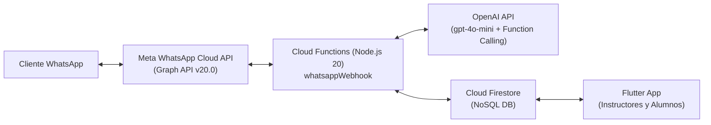
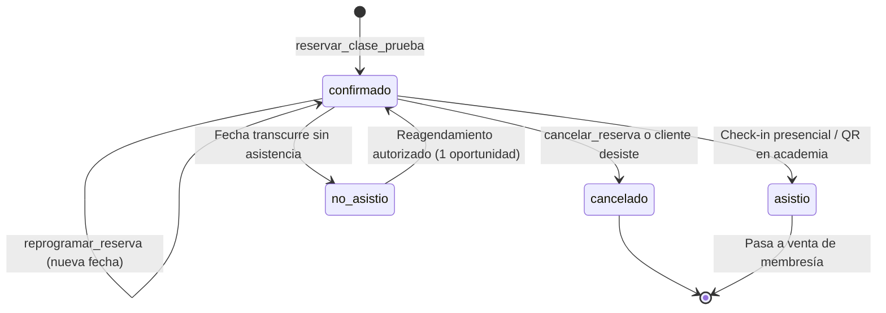
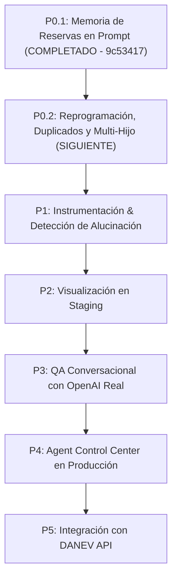

# Estado Actual del Proyecto GINGA (CURRENT-STATE)

> **Documento Maestro de Estado y Arquitectura**  
> **Última Actualización:** 2026-11-11  
> **Rama Actual:** `fix/real-whatsapp-logic`  
> **Commit Base:** `3058ada` (main) $\rightarrow$ `b1c3af6` (harness) $\rightarrow$ `9c53417` (P0.1)

---

## 1. Arquitectura y Tecnologías

El sistema real de GINGA es una plataforma de atención comercial y gestión de academia de Capoeira que opera como un **single-agent con function calling**:



### Componentes Clave:
- **Runtime Backend:** Node.js 20 en Google Cloud Functions (Firebase Functions v4.4.1).
- **Orquestación Conversacional:** Modelo `gpt-4o-mini` vía OpenAI Chat Completions API con tool-calling secuencial (tope de 4 rondas por turno).
- **Base de Datos:** Cloud Firestore en modo nativo (`capoeirafiu-ea8ljo`).
- **Canal de Mensajería:** Meta WhatsApp Cloud API con verificación de firma HMAC-SHA256 (`X-Hub-Signature-256`), deduplicación por `wa_message_id` y debounce de 5.0 segundos.
- **Frontend Móvil:** Aplicación Flutter multirol (`alumno`, `profesor`) en iOS y Android.
- **Harness de Pruebas Aislado (`real_agent_harness/`):** Servidor local (`http://127.0.0.1:3333`) que ejecuta el código real de `functions/index.js` en memoria con emuladores puros de Firestore, OpenAI y WhatsApp.

---

## 2. Ramas y Commits Relevantes

| Rama | Commit HEAD | Propósito y Estado |
|---|---|---|
| **`main`** | `3058ada` | **Producción activa.** Coincide exactamente con la revisión `whatsappWebhook v67` desplegada en Google Cloud el 23-OCT-2026. Tag: `pre-live-original-2026-10-27`. |
| **`fix/real-whatsapp-logic`** | `9c53417` | **Rama de desarrollo real activa.** Contiene el harness de pruebas (`b1c3af6`) y la corrección P0.1 de reconocimiento de reservas (`9c53417`). |
| `stabilization/pre-live-2026-10-28` | `caf628a` | Línea independiente de estabilización previa al LIVE de TikTok (controles de seguridad e idempotencia). |
| `demo/tiktok-live-2026-10-28` | `7243a7f` | Línea exclusiva de demostración visual en memoria para grabación y TikTok LIVE (código aislado en `demo/`). |

---

## 3. Estado Real: Producción vs. Desarrollo vs. Simulador

- **Producción (`whatsappWebhook v67`):**
  - Opera con amnesia de reservas: `generarSystemPrompt` no consulta `/reservas`.
  - Sufre bloqueo de reservas si el lead tiene una reserva cancelada o pasada.
  - No soporta reprogramación de fechas; arriesga alucinaciones de confirmación de palabra.
- **Desarrollo Local (`fix/real-whatsapp-logic` - Commit `9c53417`):**
  - **P0.1 implementado:** `generarSystemPrompt` recibe `leadId` y consulta `/reservas` activas en `America/Lima`.
  - Inyecta `[RESERVAS CONFIRMADAS VIGENTES DE ESTE LEAD]` con reglas que prohíben pedir nombre/edad u ofrecer agendar de nuevo.
  - Filtro fail-safe ante caídas de Firestore y neutralidad de género.
- **Simulador Local (`real_agent_harness/`):**
  - Activo en `http://127.0.0.1:3333`.
  - Ejecuta el archivo real `functions/index.js` mediante Node.js `vm.compileFunction`.
  - Emula Firestore en memoria con fixtures de Cusco (`config/negocio`, `clases`, `users`).
  - Permite pruebas automáticas y manuales con costo cero y sin tocar la nube.

---

## 4. Catálogo de Tools Actuales

Ubicadas en `functions/index.js` (`AVAILABLE_TOOLS`):

1. **`consultar_horarios_disponibles`:**
   - *Lectura:* `/clases` (where `tipo == 'regular'`), `/config/negocio`.
   - *Salida:* Texto formateado con horarios, edades, cupos, sede Cusco, precios (S/140 regular, S/260 promo acompañados, S/380 y S/720 multimes) y número de Yape.
2. **`guardar_perfil_lead`:**
   - *Escritura:* `whatsapp_leads/{leadId}.perfil_personas`.
   - *Parámetros:* `personas` (Array de `{nombre, tipo, edad}`).
   - *Defecto actual:* Sobrescribe todo el array; si se registra un segundo hijo en un mensaje posterior, borra al primero.
3. **`reservar_clase_prueba`:**
   - *Lectura:* `/whatsapp_leads`, `/clases`, `/reservas`.
   - *Escritura (Transaccional):* Crea `/reservas/{id}`, actualiza `whatsapp_leads` (`reserva_id`, `fecha_clase_reservada`) y crea notificación para el profesor en `/users/{instId}/notificaciones`.
   - *Defectos actuales:*
     - Chequeo de duplicados (`existentesSnap`) corre fuera de la transacción Firestore.
     - Bloquea erróneamente reservas con `status == 'cancelado'` o con `fecha_clase` en el pasado.
     - No permite reprogramar; si el lead pide cambiar de martes a jueves (misma clase `M, J`), colisiona y rechaza.
4. **`marcar_seguimiento_humano`:**
   - *Escritura:* Actualiza `whatsapp_leads.status = 'requiere_atencion'`, crea notificaciones batch en `/users` (rol profesor) y alerta por WhatsApp al instructor.
   - *Defecto actual:* No pausa las respuestas automáticas de la IA (`ai_habilitada` sigue en `true`).

---

## 5. Pruebas Existentes y Resultados

### A. Suite de Reconocimiento de Reservas P0.1 (`test_p01_recognition.js`):
- **14 de 14 pruebas pasaron (100% PASS):**
  - Caso A: Lead nuevo sin reservas $\rightarrow$ Prompt limpio.
  - Caso B: Reserva futura confirmada $\rightarrow$ Inyectada con fecha y hora.
  - Caso C: Reserva para hoy pendiente $\rightarrow$ Reconocida como HOY.
  - Caso D: Reserva cancelada $\rightarrow$ Descartada de vigentes.
  - Caso E: Reserva pasada $\rightarrow$ Descartada de vigentes.
  - Caso F: Estado `asistio` $\rightarrow$ Descartado de pendientes.
  - Caso G: Estado `no_asistio` $\rightarrow$ Descartado de pendientes.
  - Caso H: Familia con dos hijos $\rightarrow$ Ambos hijos listados independientemente.
  - Caso I: Error de Firestore $\rightarrow$ Fail-safe sin crasheos.
  - Caso J: Directivas contra duplicación de registro $\rightarrow$ Verificadas.
  - Caso K: Reserva de hoy que ya terminó $\rightarrow$ Descartada.
  - Caso L: Protección contra promesas falsas de reprogramación $\rightarrow$ Verificada.
  - Caso M: Neutralidad de género $\rightarrow$ Verificada.
  - Caso N: Aviso de seguridad ante caída de BD $\rightarrow$ Verificado.

### B. Suite de Línea Base (`suite_runner.js`):
- Caso 1: Consulta de horarios $\rightarrow$ **OK**.
- Caso 2: Reserva vigente $\rightarrow$ **OK** (Corregido en P0.1).
- Casos 3 a 8: Duplicados espurios, colisión de reprogramación, falsa confirmación y sobreescritura multi-hijo $\rightarrow$ **DEFECTOS BASELINE DOCUMENTADOS**.
- Caso 9: Control humano $\rightarrow$ **OK**.

---

## 6. Especificación Técnica P0.2: Reprogramación, Duplicados y Multi-Persona (DISEÑO)

> [!IMPORTANT]
> **Estado:** DISEÑO APROBADO PARA IMPLEMENTACIÓN. No implementado en código productivo todavía.

### 6.1. Reglas de Negocio y Estados de Reserva

El ciclo de vida formal de una reserva de clase de prueba se rige por la siguiente máquina de estados:



- **`confirmado`:** Reserva activa vigente con fecha futura o de hoy pendiente de inicio.
- **`cancelado`:** El cliente avisó que no podrá ir o canceló la cita. **NO debe bloquear nuevas reservas futuras**.
- **`asistio`:** El alumno asistió a su clase de prueba (registrado en `/asistencias` y `/reservas`).
- **`no_asistio`:** La fecha pasó y no hubo check-in.
- **Diferencia Operativa:**
  - *Reserva:* Registro comercial en `/reservas` asociado a un lead de WhatsApp.
  - *Asistencia:* Registro físico en `/asistencias` vinculado a una sesión presencial.
  - *Matrícula:* Alta de alumno regular en `/users` (`rol: alumno`) con pagos mensuales en `/alumnos` o `/pagos`.

### 6.2. Estrategia de Reprogramación: ¿Mismo Documento o Cancelar y Crear?
**Decisión Técnica:** **Mismo documento con historial de cambios (`audit_trail`).**
- *Justificación:* Mantener el mismo `reservaId` preserva la trazabilidad del lead en la app del instructor (evita generar notificaciones huérfanas o duplicar filas en la UI del profesor).
- *Campos a actualizar atómicamente:*
  - `fecha_clase`: Nuevo `Timestamp` a mediodía hora Lima.
  - `dias`: Días de la clase.
  - `updated_at`: `FieldValue.serverTimestamp()`.
  - `reprogramaciones`: Array append `{ fecha_anterior, fecha_nueva, motivo, timestamp }`.

### 6.3. Contratos de Herramientas para P0.2

#### Tool 1: `reprogramar_reserva` (NUEVA)
```json
{
  "name": "reprogramar_reserva",
  "description": "Cambia la fecha de una reserva de clase de prueba ya existente para un asistente. Úsala cuando el cliente pida cambiar de día (ej. pasar del martes al jueves).",
  "parameters": {
    "type": "object",
    "properties": {
      "nombre": {
        "type": "string",
        "description": "Nombre de pila del asistente cuya reserva se reprograma."
      },
      "nueva_fecha": {
        "type": "string",
        "description": "Nueva fecha solicitada en formato AAAA-MM-DD. Si no es válida o no hay clase ese día, el backend calcula la fecha permitida más próxima."
      },
      "motivo": {
        "type": "string",
        "description": "Motivo breve del cambio si el cliente lo indicó."
      }
    },
    "required": ["nombre"]
  }
}
```
*Comportamiento del Handler:*
1. Busca la reserva activa (`status == 'confirmado'`) para ese `lead_id` y `nombre`.
2. Si no encuentra ninguna reserva confirmada: devuelve código `ERR_NO_ACTIVE_RESERVATION`.
3. Valida la `nueva_fecha` contra el patrón de días de la clase.
4. Ejecuta transacción Firestore actualizando `fecha_clase`, agregando la traza en `reprogramaciones`, y actualizando `whatsapp_leads`.
5. Devuelve confirmación con fecha formateada: *"Reserva reprogramada exitosamente para [nombre] el [fecha] a las [hora]"*.

#### Tool 2: `reservar_clase_prueba` (AJUSTES)
1. **Filtro de duplicados corregido:**
   ```javascript
   // Solo colisiona si existe una reserva con status == 'confirmado' AND fecha_clase >= hoyMedianoche
   const colisiona = existentesSnap.docs.some(d => {
     const data = d.data();
     const esMismoNombre = (data.nombre_persona || '').trim().toLowerCase() === nombrePersona.trim().toLowerCase();
     const esActiva = (data.status || 'confirmado') === 'confirmado';
     const fechaValida = data.fecha_clase?.toDate() >= hoyMedianoche;
     return esMismoNombre && esActiva && fechaValida;
   });
   ```
2. **Duplicados cancelados o pasados:** Si la reserva previa está `cancelado`, `asistio`, `no_asistio` o con fecha en el pasado, **permite agendar la nueva reserva**.
3. **Idempotencia Transaccional:** La comprobación de duplicados se mueve **DENTRO** de la transacción `runTransaction` para prevenir race conditions por mensajes simultáneos.

#### Tool 3: `guardar_perfil_lead` (AJUSTE MULTI-HIJO)
- En lugar de sobrescribir `perfil_personas` en bloque, realiza una **fusión por nombre** (`merge by lowercase name`):
  Conserva a los hijos previos y añade o actualiza al nuevo.

### 6.4. Preparación para Sedes Futuras (Compatibilidad Retroactiva)
- **Modelo de Datos en `/reservas`:**
  - `sede_id`: String opcional (default `'cusco_magisterio'` o derivado de `clase.sede`).
  - `session_id`: String opcional (para futura vinculación directa a sesiones específicas).
  - Documentos antiguos sin estos campos: compatibles al 100%, asumen sede principal de Cusco.
- **Cero Sedes Ficticias:** La configuración de producción mantiene únicamente la sede real de Cusco (`Av. de la Cultura E-4`).

### 6.5. Códigos de Resultado Normalizados (Auditoría DANEV)
Para facilitar la telemetría del futuro Agent Control Center y la API de DANEV:
- `RES_OK_CREATED`: Reserva creada y persistida.
- `RES_OK_RESCHEDULED`: Reserva modificada y persistida.
- `RES_ERR_DUPLICATE_ACTIVE`: Intento de duplicar cita ya confirmada.
- `RES_ERR_NO_ACTIVE_RESERVATION`: Intento de reprogramar sin cita previa.
- `RES_ERR_CLASS_FULL`: Clase sin cupos disponibles.
- `RES_ERR_ATTENDED_ALREADY`: Asistió previamente; requiere autorización humana.

---

## 7. Roadmap Priorizado



---

## 8. Riesgos de Seguridad y Operación

1. **Riesgo de Falsa Promesa (False Confirmation):** Mitigado en P0.1 a nivel de prompt y se blindará en P0.2 al proveer la tool `reprogramar_reserva`.
2. **Concurrencia en Webhooks:** Si un usuario envía dos mensajes en menos de 2 segundos, el debounce de 5.0s mitiga la duplicidad de llamadas, pero P0.2 incluirá el chequeo de duplicados dentro de la transacción Firestore como defensa en profundidad.
3. **Índices de Firestore:** Las consultas con doble igualdad (`lead_id == x` AND `status == 'confirmado'`) no requieren índice compuesto. Si se añaden ordenamientos por `fecha_clase` en Firestore, se requerirá desplegar el índice compuesto `reservas (lead_id ASC, status ASC, fecha_clase ASC)`.

---

## 9. Integración Futura con DANEV

- El agente operará como nodo emisor de eventos auditables mediante llamadas HTTP a los endpoints de DANEV (`/api/v1/events/agent`).
- Esquema de eventos estandarizado con UUID de evento, timestamp ISO, hash de lead, métricas de latencia y diffs de estado de reservas.
